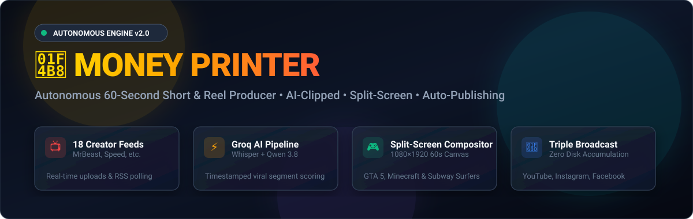
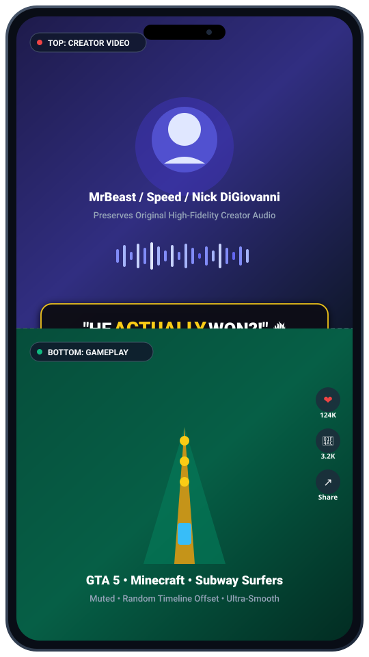
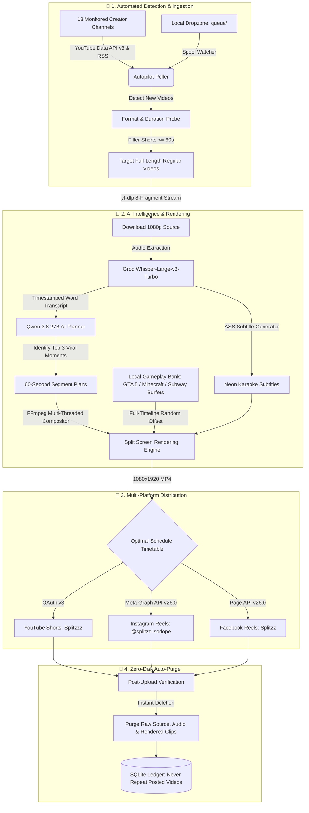

# 💸 Money Printer — Autonomous Social Media Shorts & Reels Engine

<p align="center">
  
</p>

<p align="center">
  
  
  
  
  
  
</p>

<p align="center">
  <b>A 100% self-hosted, autonomous content machine. Automatically monitors top creators, clips viral 60-second highlights, composites high-retention split-screen gameplay, burns kinetic karaoke captions, and broadcasts simultaneously to YouTube, Instagram, and Facebook with zero disk accumulation.</b>
</p>

---

## 🎬 The Viral Split-Screen Format

<p align="center">
  
</p>

The engine formats every clip into the industry-standard **9:16 vertical canvas (1080×1920)** with dynamic visual balance designed for peak audience retention:

```text
┌─────────────────────────────────────────┐
│                                         │
│               TOP HALF                  │  1080 × 960 px
│         Creator Video Content           │  Original Creator Audio
│                                         │
├─────────────────────────────────────────┤
│       ★ KINETIC KARAOKE SUBTITLES ★     │  Word-synced neon highlights
├─────────────────────────────────────────┤
│                                         │
│              BOTTOM HALF                │  1080 × 960 px
│      Satisfying Gameplay Footage        │  Rotates GTA 5, Minecraft &
│                                         │  Subway Surfers (Muted)
└─────────────────────────────────────────┘
```

---

## ⚡ High-Level System Architecture



---

## 🌟 Core Features & Superpowers

### 🤖 1. Hands-Free Channel Autopilot
- Continuously tracks **18 top creator channels** (MrBeast, Outdoor Boys, CarryMinati, IShowSpeed, BeastBoyShub, GothamChess, Dream, etc.).
- Probes official YouTube Data API metadata to filter out existing Shorts and grab only **full-length regular videos**.
- Seamlessly adds new videos into `links.txt` without requiring browser cookies or hitting scraping timeouts.

### 🎮 2. Dynamic Gameplay Rotation & Random Seeking
- **Automatic Game Cycling**: Rotates across **GTA 5 Stunts**, **Minecraft Parkour**, and **Subway Surfers** so consecutive clips never feature the same game.
- **12+ Local Gameplay Videos**: Cycles across multiple high-bitrate footage files in `assets/gameplay/`.
- **Full-Timeline Random Offset**: Rather than playing from the same spot, the engine seeks randomly across the **entire 10–30 minute length** of the gameplay file (`random.uniform(0.0, max_start)`). Every Short gets an exciting, unique scene!

### ⚡ 3. Blazing Fast Rendering & AI Pipeline
- **AI Highlight Selection**: Instead of chopping an entire video into 45 redundant parts, Groq AI extracts the **top 3 viral highlights** (15x faster turnaround!).
- **Hardware-Accelerated FFmpeg**: Configured with `-preset veryfast`, `-sws_flags bicubic`, and `-threads 0` multi-core CPU encoding.
- **Instant Transcription**: Uses Groq `whisper-large-v3-turbo` for near-instant transcription and word-level karaoke caption sync.

### 🗑️ 4. Zero-Disk Accumulation (Auto-Purge)
- Automatically purges raw source downloads, intermediate audio files, thumbnails, and rendered MP4s immediately after uploading.
- Prevents disk exhaustion (`[Errno 28] No space left on device`) and keeps your drive clean.
- SQLite audit records prevent ever repeating or re-downloading previously processed content.

### 🌐 5. Live Mission Control Web Dashboard (`http://localhost:5050`)
- **Real-Time Health Status**: Live status monitors for YouTube, Instagram, Facebook, Groq AI, and FFmpeg.
- **Dropzone File Upload**: Drag-and-drop local video files directly from your browser.
- **Quick Queue**: Paste any YouTube link to process on-demand.
- **Published Ledger**: Direct permalinks to all live published Shorts and Reels.

---

## 📺 Configured 18 Monitored Creators

| # | Creator | Channel ID | YouTube Handle | Category |
| :---: | :--- | :--- | :--- | :--- |
| 1 | **MrBeast** | `UCX6OQ3DkcsbYNE6H8uQQuVA` | `@MrBeast` | Entertainment / Challenges |
| 2 | **Outdoor Boys** | `UCfpCQ89W9wjkHc8J_6eTbBg` | `@OutdoorBoys` | Bushcraft / Survival |
| 3 | **Nick DiGiovanni** | `UCMyOj6fhvKFMjxUCp3b_3gA` | `@NickDiGiovanni` | Culinary / Fast-Paced Cooking |
| 4 | **IShowSpeed** | `UCWsDFcIhY2DBi3GB5uykGXA` | `@IShowSpeed` | Gaming / High Energy Comedy |
| 5 | **BeastBoyShub** | `UCI86prlqXhbkREDMTaORvLQ` | `@BeastBoyShub` | Gaming / Commentary |
| 6 | **GothamChess** | `UCQHX6ViZmPsWiYSFAyS0a3Q` | `@GothamChess` | Chess Highlights / Fast Commentary |
| 7 | **Dream** | `UCTkXRDQl0luXxVQrRQvWS6w` | `@Dream` | Minecraft / Storytelling |
| 8 | **Not Your Type** | `UCKnNrlSJF_hWoBSz1lY_D7g` | `@notyourtype` | Animated Stories / Humor |
| 9 | **HardToonz** | `UCIPqzmQYnE2HyZyLkoCJ3Iw` | `@HardToonz` | Animation / Parody |
| 10 | **Samay Raina** | `UCAov2BBv1ZJav0c_yHEciAw` | `@SamayRainaOfficial` | Standup Comedy / Reality |
| 11 | **CarryMinati** | `UCj22tfcQrWG7EMEKS0qLeEg` | `@CarryMinati` | Satire / Parody / Podcasts |
| 12 | **Warangal Diaries** | `UCWSyWK6oS5VL3RrJZuWsdSA` | `@WarangalDiaries` | Regional Comedy / Skits |
| 13 | **DiscoveryChannelInd** | `UCBLF5teKEUzTN5gZ2zgR0kQ` | `@discoverychannelind` | Wild Encounters / Expeditions |
| 14 | **Shakeel Bhai** | `UCAkMKodEd1z5lDo-e0MY5WA` | `@shakeelbhaiofficial` | Street Food / Cooking Comedy |
| 15 | **Grox** | `UCK5vUVoJsEVc7JeXQ8XiX7w` | `@groxmc` | Minecraft Challenges |
| 16 | **Wemmbu** | `UCkzzNLnuM-VsATWC53ehwOQ` | `@wemmbumc` | Minecraft Battles |
| 17 | **FlameFrags** | `UCvYPobTo42NM36X7VC4dLhA` | `@flamefragsmc` | Minecraft Tournaments |
| 18 | **Donut** | `UCL6JmiMXKoXS6bpP1D3bk8g` | `@donut` | Automotive / Restoration / Racing |

---

## 🚀 Quick Start Guide

### 1. Prerequisites
- **Python 3.12+**
- **FFmpeg & FFprobe** installed and added to your system `PATH`.
- **Node.js** (for yt-dlp player challenge extraction).

### 2. Installation
```powershell
# Clone the repository
git clone https://github.com/Naserkhan07/money-printer.git
cd money-printer

# Set up virtual environment
python -m venv .venv
.\.venv\Scripts\activate

# Install dependencies
pip install -r requirements.txt # or pip install -e .
```

### 3. Setup Environment Variables
Copy `.env.example` to `.env` and fill in your API credentials:
```powershell
cp .env.example .env
```
Key credentials required:
- `GROQ_API_KEY`: Fast AI transcription and metadata generation ([Groq Console](https://console.groq.com/)).
- `client_secret.json`: Downloaded from Google Cloud Console with YouTube Data API enabled.
- `INSTAGRAM_ACCESS_TOKEN`: Meta Graph API token for Instagram Professional accounts.
- `FACEBOOK_PAGE_ID` & `FACEBOOK_ACCESS_TOKEN`: Page token for Facebook Reels.

### 4. Verify System & Token Health
Run the built-in diagnostic preflight tool:
```powershell
.\preflight.bat
```
*(or run: `python -m shorts_bot.preflight`)*

Expected output:
```text
============================================================
🚀 AUTO-POSTER System & Token Health Preflight
============================================================
Overall Status: HEALTHY

[TOOLS]
  ✅ ffmpeg: READY
  ✅ ffprobe: READY

[SERVICES & PLATFORMS]
  ✅ Groq: READY (qwen/qwen3.8-27b | whisper-large-v3-turbo)
  ✅ YouTube: READY (Splitzzz)
  ✅ Instagram: READY (@splitzz.isodope)
  ✅ Facebook: READY (Splitzz)
  ✅ Cloudinary: CONFIGURED (Root)
============================================================
```

---

## 🎮 Launching the Bot

### Option 1: One-Click Startup (Recommended)
Double-click [`start.bat`](file:///c:/Users/Naveed/Documents/money%20printer/start.bat). It automatically starts:
1. **Live Mission Control Dashboard** at `http://localhost:5050`.
2. **Autonomous Background Worker** (Autopilot poller + queue downloader + uploader).

### Option 2: Running Individual Services
- **Start Web Dashboard only**:
  ```powershell
  .\start_dashboard.bat
  ```
- **Start Background Automation Worker only**:
  ```powershell
  .\start_worker.bat
  ```

---

## 📁 Repository Structure

```text
money-printer/
├── assets/
│   └── gameplay/               # High-res local gameplay (GTA 5, Minecraft, Subway Surfers)
├── queue/                      # Dropzone for local video processing
├── shorts_bot/                 # Core modular engine package
│   ├── ai.py                   # Groq Whisper transcription & Qwen metadata planner
│   ├── autopilot.py            # Zero-quota 18-channel YouTube monitor
│   ├── captions.py             # Word-synced ASS karaoke subtitles generator
│   ├── config.py               # Central configuration parser
│   ├── dashboard.py            # Mission Control web dashboard & API
│   ├── db.py                   # SQLite repository & deduplication ledger
│   ├── downloader.py           # yt-dlp multi-fragment stream downloader
│   ├── facebook.py             # Facebook Reels Graph API publisher
│   ├── file_queue.py           # Execution coordinator & retry orchestrator
│   ├── gameplay.py             # Split-screen gameplay manager & random seeker
│   ├── instagram.py            # Instagram Reels Graph API publisher
│   ├── media.py                # Multi-threaded FFmpeg rendering engine
│   ├── preflight.py            # Diagnostic health checker
│   ├── scheduler.py            # Multi-slot audience timetable scheduler
│   ├── spool.py                # Local queue/ dropzone watcher
│   └── youtube.py              # YouTube Data API v3 publisher
├── .env.example                # Safe environment variable template
├── channels.toml               # Creator channels list & scheduling settings
├── dashboard.py                # Dashboard runner
├── instagram_captions.txt      # Caption rotation lines
├── instagram_hashtags.txt      # High-engagement hashtag bank
├── links.txt                   # Active queue of URLs to download
├── main.py                     # Main CLI entrypoint
├── preflight.bat               # Health check launcher
├── pyproject.toml              # Build & dependency metadata
├── start.bat                   # One-click dual launcher
├── start_dashboard.bat         # Dashboard batch launcher
└── start_worker.bat            # Worker batch launcher
```

---

## 📄 License

This project is licensed under the MIT License — see the [LICENSE](LICENSE) file for details.
